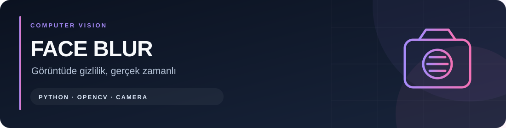
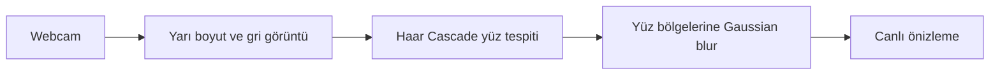

# Yüz Bulanıklaştırma Uygulaması



[](https://github.com/symNistaken/face-blur-app/actions/workflows/checks.yml)
[](https://www.python.org/downloads/)

[](LICENSE)

Python ve OpenCV ile webcam görüntüsündeki yüzleri tespit edip gerçek zamanlı bulanıklaştıran masaüstü uygulaması. Yüz tespiti için projedeki Haar Cascade XML modeli kullanılır.

## Nasıl çalışır?



1. Varsayılan kamera (`0`) açılır.
2. Tespit için görüntü yarı boyuta küçültülür ve griye dönüştürülür.
3. Haar Cascade yüz bölgelerini bulur.
4. Bulunan bölgeler asıl görüntüde Gaussian blur ile bulanıklaştırılır.
5. Sonuç OpenCV penceresinde gösterilir; **`q`** ile uygulama kapanır.

Kaynak kodda görüntüyü dosyaya kaydetme veya ağ üzerinden gönderme işlemi yoktur. Yüz tespiti her karede başarılı olmayabilir; bu uygulama tam anonimleştirme garantisi vermez.

## Gereksinimler

- Python; yerel çalışma için Python 3.10 önerilir.
- OpenCV grafik penceresini gösterebilen masaüstü oturumu.
- Çalışan webcam ve kamera erişim izni.

Kaynak kod OpenCV destekli masaüstü sistemlerde çalıştırılabilir. Windows dışındaki kamera ve pencere davranışları ayrıca doğrulanmalıdır. OpenCV ve NumPy sürümleri Python 3.10 için sabitlenmiştir; tüm sistem/kamera sürücülerinde uyum garantisi verilmez.

## Kurulum

```bash
git clone https://github.com/symNistaken/face-blur-app.git
cd face-blur-app
python -m venv .venv
```

Windows PowerShell:

```powershell
.\.venv\Scripts\python.exe -m pip install -r requirements.txt
.\.venv\Scripts\python.exe src/main.py
```

Linux/macOS:

```bash
.venv/bin/python -m pip install -r requirements.txt
.venv/bin/python src/main.py
```

Sanal ortam etkinleştirildiyse aynı işlem `python src/main.py` ile yapılabilir. Pencereye odaklanıp **`q`** tuşuna basarak çık.

## Proje yapısı

```text
src/
├── main.py                  # Kamera, cascade yükleme ve pencere döngüsü
├── face_blur.py             # Yüz tespiti ve Gaussian blur
├── utils.py                 # Boyutlandırma ve gri görüntü yardımcıları
└── haar_cascade/
    └── haarcascade_frontalface_default.xml
requirements.txt            # OpenCV ve NumPy
main.spec                   # Windows PyInstaller paketleme tanımı
```

## Windows executable oluşturma

PyInstaller çalışma bağımlılığı değildir; paketleme için ayrıca kur:

```powershell
.\.venv\Scripts\python.exe -m pip install pyinstaller
.\.venv\Scripts\python.exe -m PyInstaller main.spec
```

Komutları depo kökünde çalıştır. `main.spec`, Haar Cascade XML dosyasını pakete ekler ve `dist/main.exe` oluşturacak şekilde tanımlıdır. Windows executable Windows üzerinde oluşturulmalıdır; kaynak kodun diğer sistemlerde çalışabilmesi Windows executable'ın taşınabilir olduğu anlamına gelmez.

Depoda eski `build/` çıktıları bulunur; bunlar kurulum için gerekli değildir ve güncel executable garantisi vermez. Antivirüs uyarısı bir dosyanın güvenli olduğunu kanıtlamaz; uyarıyı incele, mümkünse kaynaktan kendi paketini oluştur.

## Sorun giderme

| Sorun | Kontrol |
| --- | --- |
| Webcam açılamıyor | Kamera iznini, bağlantıyı ve kamerayı kullanan diğer programları kontrol et. |
| Yanlış kamera açılıyor | `python src/main.py --camera 1` gibi bir komutla kamera indeksini seç. |
| Cascade yüklenemiyor | XML dosyasının `src/haar_cascade/` altında olduğunu kontrol et; paketlemede `main.spec` kullan. |
| Pencere açılamıyor | Grafik oturumu ve `opencv-python` kurulumunu kontrol et; headless paket pencere açmaz. |
| Bazı yüzler bulanıklaşmıyor | Işık, yüz açısı ve görüntü kalitesi tespiti etkiler. Çıktıyı paylaşmadan önce incele. |
| Modül bulunamadı | Paketleri uygulamayı çalıştırdığın aynı Python/sanal ortamla kur. |

## Kontrol ve sınırlar

```bash
python -m compileall -q src
python -m unittest discover -s tests -v
```

Sözdizimi kontrolü kamera erişimini veya tespit kalitesini doğrulamaz. Kamerasız 9 test; açılmayan kamera, eksik cascade, okuma/pencere hatası, `q` ile kapanma, kaynak temizliği ve bulanıklaştırma bölgesini denetler. Gerçek cihaz açılmaz. Canlı deneme için `src/main.py` çalıştır ve yüzün farklı açı/ışık koşullarında nasıl göründüğünü kontrol et. Kamera görüntüsündeki her yüzün her zaman gizleneceği varsayılmamalıdır.

## Geliştirici ve kullanım koşulları

[Berkay Seyman](https://github.com/symNistaken).

**[MIT Lisansı](LICENSE)** ile yayımlanır. Ticari kullanım, değiştirme ve dağıtım serbesttir; telif bildirimi ve lisans metni korunmalıdır. Yazılım garanti olmadan sunulur.

Copyright (c) 2026 Berkay Seyman. OpenCV, Haar Cascade modeli ve diğer bağımlılıkların kendi lisansları ayrıca geçerlidir.

## Otomatik kontroller

[GitHub Actions](https://github.com/symNistaken/face-blur-app/actions) her push ve pull request için Python sözdizimini ve kamerasız davranış testlerini çalıştırır. Gerçek kamera erişimi ve yüz tespiti başarısı bu testlerle garanti edilmez.
